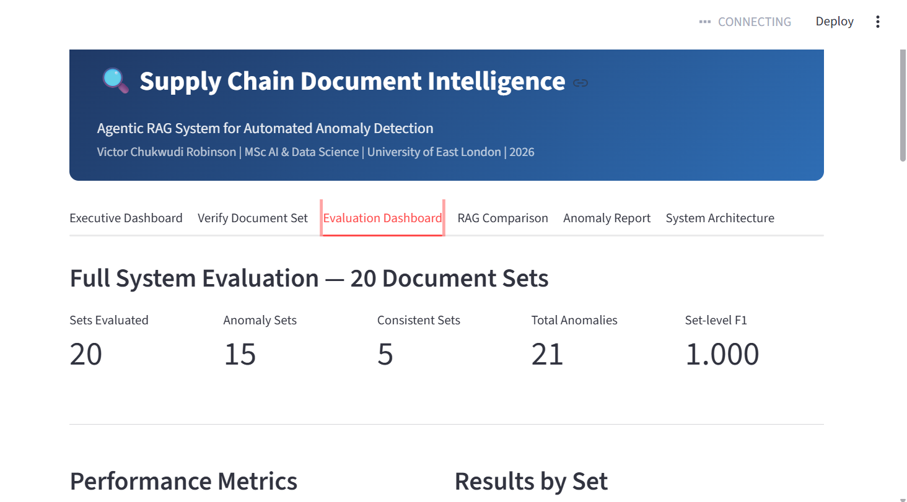

# Agentic RAG System for Automated Document Intelligence in Supply Chain Operations

An agentic Retrieval-Augmented Generation system that detects anomalies across linked supply chain documents — purchase orders, invoices, delivery notes, and goods received notes — by reasoning across multiple documents rather than answering from a single retrieved chunk.

Built as an MSc dissertation project (AI & Data Science, University of East London), grounded in real-world logistics document intelligence problems.



## Results

Evaluated on a 56-document **synthetic** corpus spanning 20 document sets: 5 internally consistent sets and 15 sets containing one of five anomaly types (price mismatch, quantity mismatch, missing document, date inconsistency, multiple errors), 3 sets each. See [About the data](#about-the-data).

| Metric | Score | Status |
|---|---|---|
| Set-level anomaly detection (20 sets) — precision / recall / F1 | 1.000 / 1.000 / 1.000 (TP 15, TN 5, FP 0, FN 0) | Recomputed from `results/evaluation_results_20sets.json` by `scripts/compute_metrics.py` |
| Wilson 95% CI, set-level precision / recall | [0.80, 1.00] | Computed by `src/statistical_significance.py` |
| Anomaly type identification — F1 | 0.974 (precision 1.000, recall 0.950) | Recorded from the dissertation evaluation; not recomputed in this repo |
| Hop Completeness (custom metric, below) | 0.975 | Recorded from `ragas_manual.py`; not recomputed in this repo |

With only 20 sets, a perfect score still has a wide interval: the data are consistent with a true recall as low as about 0.80.

**Hybrid system vs. traditional RAG.** On a head-to-head of **6 hand-picked cases**, the hybrid system was correct on 6/6 and the single-hop baseline on 4/6. McNemar's test gives p = 0.50, so six cases is too few to claim a statistically reliable difference; it is a directional result only. Two caveats: the saved comparison file (`results/comparison_results.json`) stores only the baseline's answers, with the system-side outcomes recorded by hand; and baseline answers were scored on whether they flagged an anomaly, not on whether the evidence they cited was right (the baseline's "correct" answer for PO-2026-2002 quotes prices that do not appear in those documents). Earlier versions of this README compared 95% on 20 sets against 67% on 6 cases. That was not a like-for-like comparison and has been removed.

On an extended 100-set synthetic corpus, precision held at 1.000 but recall fell to 0.573. The dissertation traces this to the regex-based field extraction layer rather than retrieval or reasoning.

**Known limitation: set-level metrics hide finding-level errors.** A set counts as correct if it is flagged correctly, even if an extra false finding is attached. For example, one logged agent run attached a quantity mismatch to PO-2026-2001 by comparing it against a delivery note from a different set (`DN-9921`, which belongs to a consistent Meridian set) instead of its own (`DN-9102`). The evaluation run itself used the correct delivery note. Finding-level precision, and cross-set retrieval leakage between suppliers with similar part codes, have not been measured.

**How to read these numbers:** the corpus is small, synthetic and generated by the same author who built the system. The scores show the approach works on controlled, labelled scenarios. They are not evidence of performance on real-world supply chain documents, which are messier. The drop on the extended corpus shows where the current system breaks.

## About the data

All documents in this repository are **synthetic**. They were generated with Python and `reportlab`, not taken from any real company.

- **Original corpus:** 20 document sets (56 PDFs) in `data/document_sets/`, with the labelled answer for every set in `ground_truth/MASTER_GROUND_TRUTH.txt`.
- **Extended corpus:** 100 document sets in `data/expanded_dataset/`, produced by `scripts/generate_expanded_dataset.py` (fixed random seed 42). Distribution: 25 consistent sets, and 15 each of price mismatch, quantity mismatch, missing document, date inconsistency and multiple errors.
- **Formats:** five fictional suppliers, each with a different document layout (formal bordered tables, minimal modern, prose letter style, pipe-delimited spreadsheet export, informal lowercase), so the extraction layer sees format variation.
- **Why synthetic:** real purchase orders, invoices and delivery notes contain commercially sensitive data. Synthetic sets let every anomaly be planted and labelled exactly, so the evaluation has a known ground truth.
- **Limitation:** synthetic documents are cleaner and more regular than real ones. Testing on real or anonymised documents is the most important next step.

## Why agentic, not standard RAG

Standard RAG retrieves a chunk and answers from it. Most supply chain anomalies aren't visible in any single document — a price discrepancy only exists in the *relationship* between a PO's agreed price and an invoice's billed price. This system uses an agent loop that plans which documents to pull, retrieves across them, and verifies its own conclusions before returning an answer, rather than a single retrieve-then-generate pass.

## Architecture

The system is a **hybrid**. A deterministic verification pipeline (retrieve the PO, invoice and delivery note for a set, extract fields, compare them with explicit rules) produces the scored evaluation results, so they contain no LLM variance and can be re-run to the same verdicts. A ReAct agent sits on top for interactive, multi-document questions and explanations. The 20-set results above score the verification pipeline; the agent layer was not independently scored.

```
Ingestion  →  Embedding  →  Agent (plan / retrieve / reason)  →  Verification
   │              │                    │                            │
   ▼              ▼                    ▼                            ▼
structure-    FAISS vector      multi-hop retrieval          cross-checks the
aware         store             across linked docs           agent's own
chunking                                                     conclusion
```

- **`ingestion_pipeline.py`** — parses PDFs (via `pdfplumber`) and applies structure-aware chunking: documents are split by their internal structure (e.g. header / line-items / summary for an invoice) rather than generic fixed-length windows, so a chunk preserves complete semantic units instead of cutting across them arbitrarily.
- **`embeddings_store.py`** — embeds chunks and builds the FAISS vector index.
- **`agent.py`** — the agentic reasoning layer: plans retrieval across potentially multiple linked documents, forms an answer.
- **`verification_pipeline.py`** — checks the agent's conclusion against the retrieved evidence before it's returned.
- **`traditional_rag.py`** — single-hop RAG baseline used for comparison.
- **`ragas_manual.py`** — custom RAGAS-style evaluation (faithfulness, answer relevancy, context precision/recall) plus the custom **Hop Completeness** metric (`compute_hop_completeness`), which scores whether an answer actually drew on evidence from every document it needed to, rather than just producing a plausible-sounding response.
- **`statistical_significance.py`** — bootstrap confidence intervals, McNemar's test, and Cohen's Kappa for the agentic-vs-baseline comparison.

## Human-in-the-loop

Two intervention points rather than one: mid-retrieval, when the agent's confidence in a retrieved document is low, and post-verification, when the verification layer flags a conclusion as anomalous. This keeps a human in the loop exactly where the system is least certain, rather than reviewing everything or nothing.

## Stack

Python · LangChain · OpenAI GPT-4o · FAISS · pdfplumber · Streamlit (evaluation dashboard)

## Running it

```bash
git clone https://github.com/Robinson7070/agentic-rag-supply-chain-dissertation.git
cd agentic-rag-supply-chain-dissertation
python -m venv venv311
venv311\Scripts\activate        # Windows
# source venv311/bin/activate   # macOS / Linux
pip install -r requirements.txt
```

Create a `.env` file:
```
OPENAI_API_KEY=your_key_here
```

Ingest and build the vector store, then run the agent:
```bash
python src/ingestion_pipeline.py
python src/embeddings_store.py
python src/agent.py
```

Run the evaluation suite:
```bash
python src/ragas_manual.py
python src/statistical_significance.py
```

Recompute the set-level metrics from the saved results (no API key needed):
```bash
python scripts/compute_metrics.py
```

Launch the evaluation dashboard:
```bash
streamlit run dashboard.py
```
The metrics tabs read `results/*.json`. The live document-query features need the vector store, which is not committed: build it first with `python src/embeddings_store.py` (requires `OPENAI_API_KEY`). Note that script indexes every PDF under `data/`, so it covers both the 20-set and the 100-set corpora.

## Status

This is dissertation research code, shared for portfolio purposes. A conference paper based on the structure-aware chunking approach and the Hop Completeness metric is in preparation — implementation detail beyond what's described above is intentionally withheld pending submission.

<!-- After the Zenodo release, add here:
## Cite this repository
[](https://doi.org/YOUR-DOI-HERE)
-->

## Author

Victor Chukwudi Robinson — [GitHub](https://github.com/Robinson7070) · MSc AI & Data Science, UEL